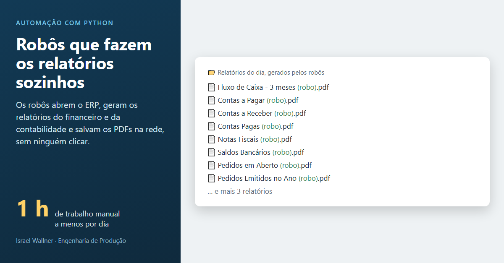

# Israel Wallner

**Engenheiro de Produção (UTFPR) · Analista de Projetos e Processos · Londrina-PR**

Transformo rotina manual em processo automático, usando Python e inteligência artificial no dia a dia de uma indústria de comunicação visual.

## O que já automatizei

**Robôs de relatórios.** Abrem o ERP (Command Perfect), geram mais de 10 relatórios do financeiro e da contabilidade em PDF e salvam na rede, sem ninguém clicar. Antes eram feitos à mão: de 40 minutos a 1 hora por dia.

**Painel Kanban das ordens de serviço.** Lê o ERP, separa cada OS pela situação (pode requisitar, aguardando projetista, comercial, atenção, data esquecida), mostra dias parados, valores a faturar e o planejamento da produção em Gantt.

**Plano de corte de chapas.** Programa para os projetistas: encaixa as peças nas chapas (ACM, MDF, inox) com o menor desperdício, usa as sobras primeiro e gera relatório, lista de corte e etiquetas com QR Code.

**Cadastro padronizado** de cerca de 400 itens de uma nova ata de fornecimento, seguindo o manual técnico do cliente.

## Ferramentas

Python · pywinauto · openpyxl · HTML/JavaScript · Command Perfect (ERP) · Excel · Power BI · Kanban · PMBOK · Lean · Claude Code (IA)

## Contato

LinkedIn: [linkedin.com/in/israel-wallner](https://www.linkedin.com/in/israel-wallner)

> Os códigos destes projetos ficam em repositórios privados, porque trabalham com dados da empresa. As imagens acima usam dados fictícios ou de exemplo.
