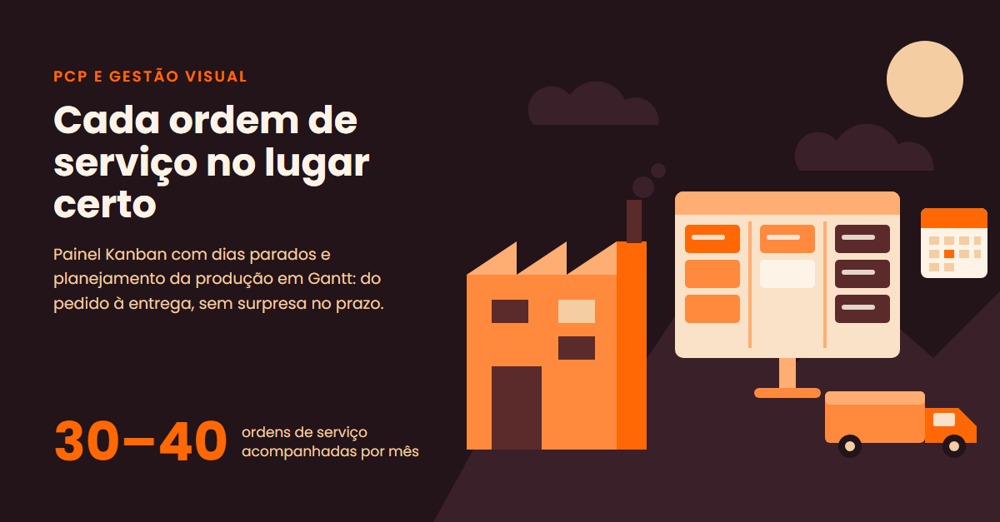

# Israel Wallner

**Engenheiro de Produção (UTFPR, formatura em dez/2026) · Analista de Projetos e Processos · Londrina-PR**

Transformo rotina manual em processo automático, usando Python e inteligência artificial no dia a dia de uma indústria de comunicação visual.

## O que já automatizei

**14 robôs em Python (RPA).** Integrados ao ERP (Command Perfect), geram mais de 10 relatórios do financeiro e da contabilidade em PDF e salvam na rede, sem ninguém clicar (antes eram feitos à mão: de 40 minutos a 1 hora por dia). Também automatizam lançamentos no ERP, como a cópia de dados para as ordens de produção (testada em 111 ordens de uma vez, sem erros) e o fechamento diário do caixa (20 segundos).

**Painel Kanban das ordens de serviço.** Lê o ERP, separa cada OS pela situação (pode requisitar, aguardando projetista, comercial, atenção, data esquecida), mostra dias parados, valores a faturar e o planejamento da produção em Gantt.

**Plano de corte de chapas.** Programa para os projetistas: encaixa as peças nas chapas (ACM, MDF, inox) com o menor desperdício, usa as sobras primeiro e gera relatório, lista de corte e etiquetas com QR Code.

**Planilha mestre padronizada** de 417 itens de uma nova ata de fornecimento, com cada item conferido no manual técnico do cliente.

**Painel em Power BI** da carteira de ordens de serviço (valor a faturar, fases, prazos e atrasos).

## Ferramentas

Python · pywinauto (RPA) · openpyxl · HTML/JavaScript · Command Perfect (ERP) · Excel avançado · Power BI · Kanban · PMBOK · Lean · Claude Code (IA)

## Contato

LinkedIn: [linkedin.com/in/israel-wallner](https://www.linkedin.com/in/israel-wallner)

> Os códigos destes projetos ficam em repositórios privados, porque trabalham com dados da empresa. As ilustrações acima foram feitas para esta página.
